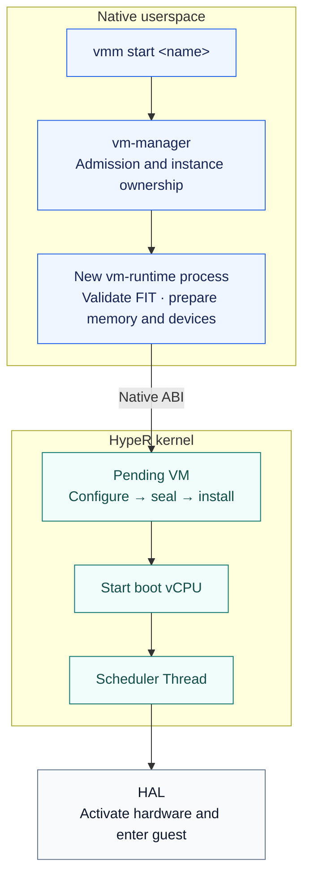
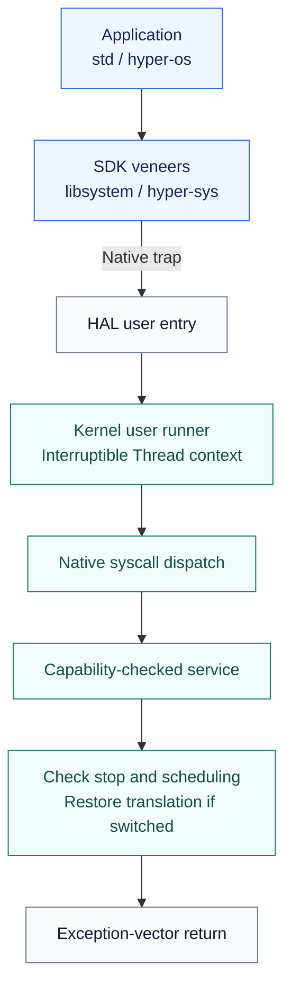
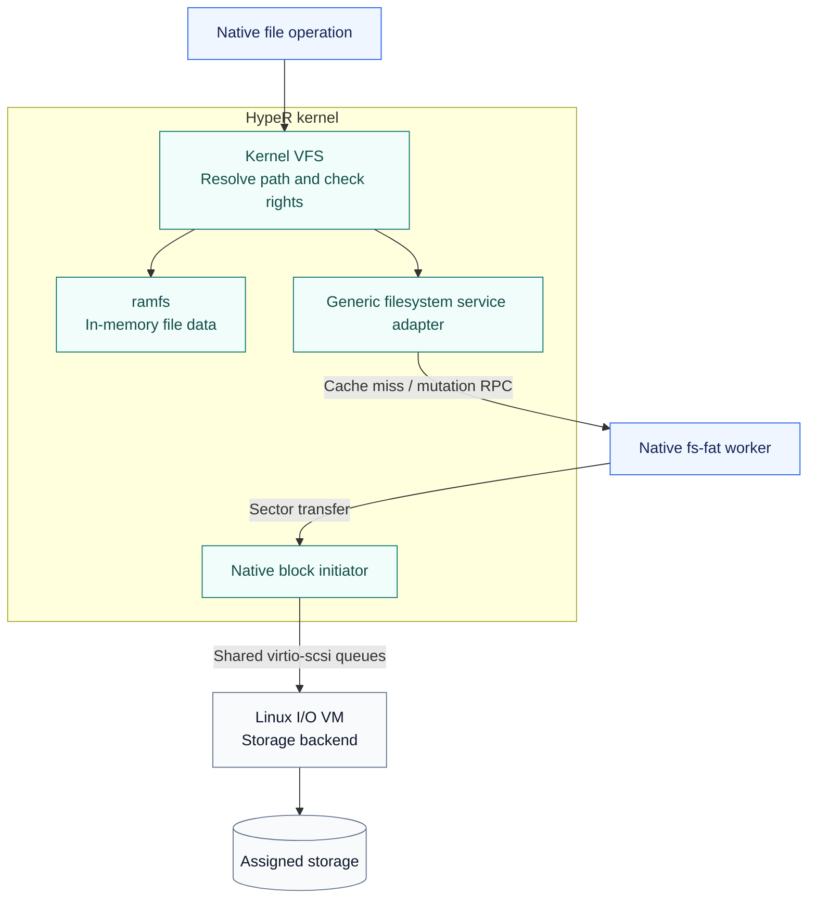
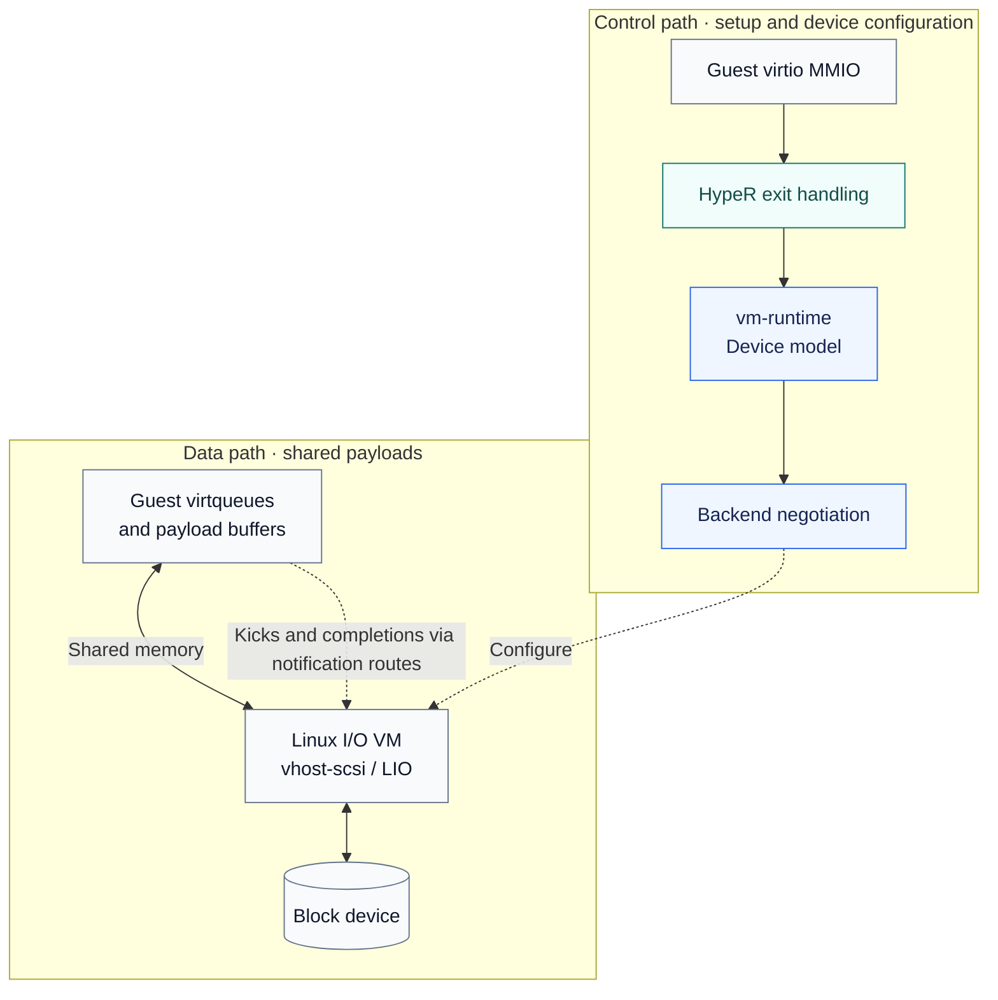
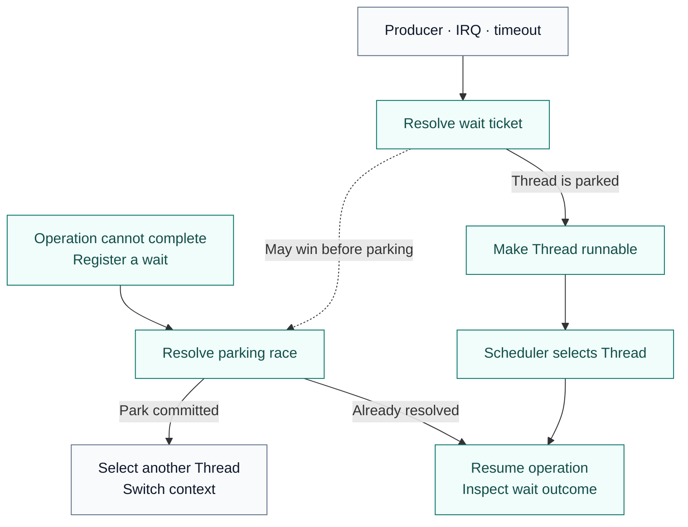
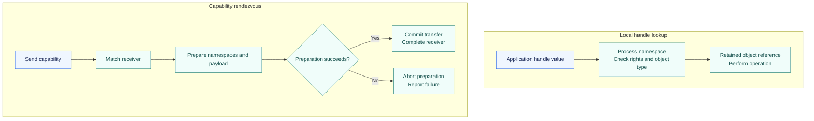
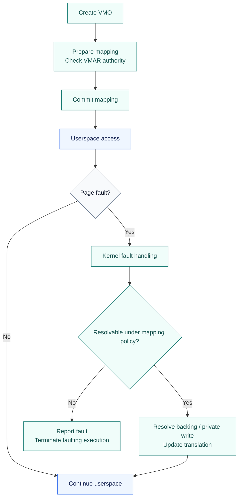
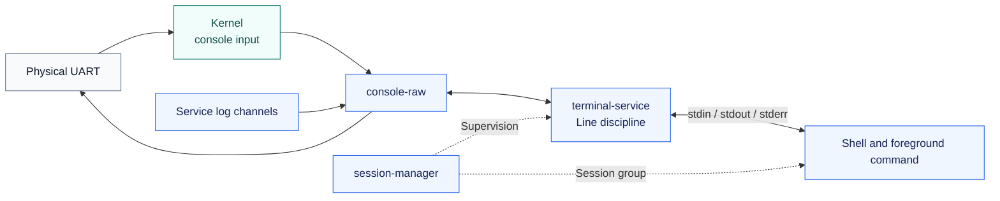
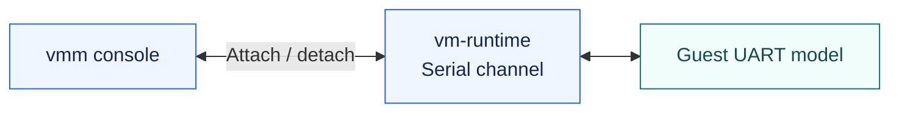

<!--
SPDX-FileCopyrightText: 2026 roolrz
SPDX-License-Identifier: Apache-2.0
-->

# Reading the code

This guide follows common operations from their public entry points to the
owners that perform them. Start with one operation and its tests, rather than
reading every module in directory order. The architecture-specific examples
use AArch64, HypeR's primary architecture; RISC-V shares kernel policy but has
its own entry and translation mechanisms.

The arrows below describe responsibility and execution flow. They are not all
direct function calls: channels, syscall continuations, scheduler handoffs and
shared queues cross several of these boundaries.

Diagrams use blue for application/service code, teal for kernel policy and
state, and slate for hardware or guest/backend boundaries. Solid arrows show
the main flow; dashed arrows show coordination or notifications. Color is only
a reading aid—the node labels identify the actual owners.

## Choose a path

- [Boot to the first application](#1-boot-to-the-first-application)
- [Creating and starting a VM](#2-creating-and-starting-a-vm)
- [Guest exceptions, MMIO and interrupts](#3-guest-exceptions-mmio-and-interrupts)
- [Native syscalls](#4-native-syscalls-from-an-application-back-to-its-thread)
- [Creating Processes and Threads](#5-creating-processes-and-threads)
- [Native files: ramfs and /data](#6-native-file-access-ramfs-versus-data)
- [Guest disk service through the I/O VM](#7-how-the-io-vm-serves-a-guest-disk)
- [Teardown and tests](#8-follow-teardown-and-tests-before-changing-a-path)
- [Scheduling, blocking and waking](#9-scheduling-blocking-and-waking-a-thread)
- [Object waits, WaitSet and atomic waits](#10-object-waits-waitset-and-futex-style-atomic-waits)
- [Handles, rights and IPC](#11-handles-rights-and-ipc-transfer)
- [Mappings, private writes and translation IDs](#12-native-mappings-private-writes-and-translation-identifiers)
- [Consoles and shell lifetime](#13-console-input-shell-lifetime-and-guest-attachment)
- [Configuration, services and packaging](#14-from-configuration-to-a-running-service-or-disk-image)
- [First contributions and validation](#15-picking-a-first-contribution-and-validating-it)

## First orientation

| Area | Start here | Responsibility |
| --- | --- | --- |
| Boot | [kernel main](https://github.com/HypeR-Proj/kernel/blob/main/src/main.rs) | Explicit initialization order and Native init startup |
| Kernel policy | [kernel modules](https://github.com/HypeR-Proj/kernel/blob/main/src/main.rs) | Processes, scheduling, capabilities, VFS and installed VMs |
| Hardware mechanisms | [HAL](https://github.com/HypeR-Proj/kernel/blob/main/hal/src/hal/vm.rs), [AArch64 backend](https://github.com/HypeR-Proj/kernel/blob/main/hal/src/arch/aarch64/mod.rs) | Hardware state and architecture-specific execution |
| Foundation | [core library](https://github.com/HypeR-Proj/kernel/blob/main/core/src/lib.rs) | Shared types, memory contracts, containers and synchronization |
| Device and VM mechanisms | [physical drivers](https://github.com/HypeR-Proj/kernel/blob/main/drivers/src/lib.rs), [VM models](https://github.com/HypeR-Proj/kernel/blob/main/vm-models/src/lib.rs), [platform discovery](https://github.com/HypeR-Proj/kernel/blob/main/platform/src/lib.rs) | Separate libraries depending on the foundation |
| Native ABI | [ABI schema](https://github.com/HypeR-Proj/abi/blob/main/schema/native.rs) | Wire layout and generated Rust/C/reference definitions |
| Applications | [application guide](https://github.com/HypeR-Proj/build/blob/main/app/README.md) | Init, shell, VM management and I/O services |

`kernel/core` owns the foundational library in `kernel/core/src/`; platform
discovery, physical drivers, VM models and trace recording have separate crates.
`kernel/hal` includes the selected architecture backend and depends on core,
platform, drivers and VM models; it does not depend on the kernel binary. An upward transition uses an
explicit registered entry/service boundary. See the
[architecture contract](https://github.com/HypeR-Proj/kernel/blob/main/docs/architecture/README.md) for the rules behind
this arrangement.

## 1. Boot to the first application

Read [boot.S](https://github.com/HypeR-Proj/kernel/blob/main/hal/src/arch/aarch64/boot.S), then the
[AArch64 bootstrap](https://github.com/HypeR-Proj/kernel/blob/main/hal/src/arch/aarch64/mod.rs), then
[kernel main](https://github.com/HypeR-Proj/kernel/blob/main/src/main.rs). Assembly handles the initial execution
environment; the common startup sequence establishes memory, scheduling,
interrupts, time and platform/VM services before publishing userspace.

[Kernel init](https://github.com/HypeR-Proj/kernel/blob/main/src/init/mod.rs) snapshots `/init`, maps the selected
bootstrap loader and prepares initial capabilities. The userspace loader
validates and maps init itself. [Bootstrap init runtime](https://github.com/HypeR-Proj/bootstrap/blob/main/init/src/runtime.rs) consumes
the service manifest and supervises core services. After handoff,
[session-manager](https://github.com/HypeR-Proj/session-manager/blob/main/src/main.rs) starts the formal terminal
and shell and supervises their session group. Pre-handoff failures use the
independent bootstrap fallback shell.

Bootstrap supervision and formal service management are independent implementations.
[Boot init](https://github.com/HypeR-Proj/bootstrap/blob/main/init/src/main.rs) starts the core services; the
[handoff sender](https://github.com/HypeR-Proj/bootstrap/blob/main/init/src/runtime/handoff.rs) starts system init
with a read-only description of those services and its prospective capabilities.
[Component-manager](https://github.com/HypeR-Proj/component-manager/blob/main/src/runtime/boot.rs) validates the
instance tree and prepares the [startup coordinator](https://github.com/HypeR-Proj/system-startup/blob/main/src/runtime/handoff.rs).
Both validate policy and lock their mappings before the manager registers receive.
One capability rendezvous moves every core Process supervisor and carries the
management capabilities and group leases. That successful operation is the ownership
commit; boot init then parks without waiting for an acknowledgement. Preparation
failure leaves core supervision and the recovery shell with boot init.

Before starting the successor, [stage-1 root policy](https://github.com/HypeR-Proj/bootstrap/blob/main/init/src/runtime/root_switch.rs)
verifies that `/system` is an independent mount and prepares a reversible root
transition. The mounted system becomes `/`; the original archive moves to `/boot`.
Namespace-root capabilities follow that transition, while fixed directory
capabilities remain confined to their original locations. Formal init opens from
the new root and receives the transition owner together with core supervision.
Before that transfer, failed launch or admission restores the bootstrap root and
fallback services. After adoption, component-manager commits the transition and
forwards domain resources; system-startup replaces core providers and submits retirement. See
[boot layout](https://hyper-proj.github.io/bootstrap/docs/boot-layout.html).

For image contents and launch commands, use the
[getting-started guide](getting-started.md) and
[Native component registry](https://github.com/HypeR-Proj/build/blob/main/mk/components.mk). A runtime failure
and a stale packaged image are different debugging problems.

## 2. Creating and starting a VM

1. [vmm](https://github.com/HypeR-Proj/vmm/blob/main/src/main.rs) parses the command and sends a management
   request. [vm-manager](https://github.com/HypeR-Proj/vm-manager/blob/main/src/manager/mod.rs), with
   [runtime launch](https://github.com/HypeR-Proj/vm-manager/blob/main/src/manager/launch.rs), owns the named definition, resource policy and per-instance
   runtime process. Start with the manager when investigating admission errors.
2. [vm-runtime `run`](https://github.com/HypeR-Proj/vm-runtime/blob/main/src/runtime.rs) validates the image, prepares
   its memory and serial channel, creates a pending VM, attaches memory and
   bootstrap information, seals it, installs it and starts the boot vCPU.
   [vm-support](https://github.com/HypeR-Proj/lib-vm-support/blob/main/src/lib.rs) contains shared loading/device
   mechanisms; [SDK VM bindings](https://github.com/HypeR-Proj/lib-rust/blob/main/hyper-os/src/vm.rs) expose the Native
   operations used here.
3. [VM services](https://github.com/HypeR-Proj/kernel/blob/main/src/vm/service.rs) resolve capabilities and
   implement `create_pending`, `seal`, `install` and `start_vcpu`.
   [Pending objects](https://github.com/HypeR-Proj/kernel/blob/main/src/vm/objects/pending.rs),
   [installed ownership](https://github.com/HypeR-Proj/kernel/blob/main/src/vm/installed.rs) and
   [registry construction](https://github.com/HypeR-Proj/kernel/blob/main/src/vm/registry/construction.rs)
   separate preparation from publication and execution ownership.
4. [The vCPU runner](https://github.com/HypeR-Proj/kernel/blob/main/src/vm/vcpu/runner.rs) is a scheduler Thread.
   [Transitions](https://github.com/HypeR-Proj/kernel/blob/main/src/vm/vcpu/transition.rs) acquire execution
   ownership and activate hardware through the HAL before guest entry.

Creation, installation and execution are separate steps. Receiving a successful
start reply does not mean the guest has reached its kernel entry or userspace.
See [VM image and boot ownership](https://github.com/HypeR-Proj/kernel/blob/main/docs/design/vm-bundle.md).

**Debugging a VM stuck in `starting`:** locate the last completed boundary:
image validation, memory preparation, backend setup, VM installation or vCPU
submission. Read the manager's state handling together with runtime reports;
a state label alone does not identify which subsystem is waiting. For a failure
after submission, use the kernel's vCPU stop reason and the guest console rather
than retrying image loading blindly.

**Secondary CPUs:** starting the boot vCPU is not the same as starting every
configured vCPU. Follow guest PSCI actions through the exception path below
and runtime control handling. Keep configured capacity, created vCPU handles
and executing vCPUs distinct when reading status output.

## 3. Guest exceptions, MMIO and interrupts

Start with [vectors.S](https://github.com/HypeR-Proj/kernel/blob/main/hal/src/arch/aarch64/vectors.S) and
[exception.rs](https://github.com/HypeR-Proj/kernel/blob/main/hal/src/arch/aarch64/exception.rs). They preserve the
machine frame, classify the exception and encode the eventual return. Then
follow the selected case:

| Guest event | Follow this code | What happens |
| --- | --- | --- |
| System register, WFI, PSCI | [vsysreg.rs](https://github.com/HypeR-Proj/kernel/blob/main/hal/src/arch/aarch64/vm/sysreg.rs) | Decode owned exit facts and produce an explicit action: resume, wait, stop or deferred completion |
| Device MMIO | [kernel device dispatch](https://github.com/HypeR-Proj/kernel/blob/main/src/vm/device/aarch64.rs) | Handle kernel-owned devices or route an admitted request to userspace |
| GIC registers | [GIC service](https://github.com/HypeR-Proj/kernel/blob/main/src/vm/device/gic.rs), [VM interrupt controller](https://github.com/HypeR-Proj/kernel/blob/main/hal/src/arch/aarch64/vm/interrupt.rs) | Decode access, synchronize hardware state and update the virtual interrupt model |
| Guest memory fault | [guest memory owner](https://github.com/HypeR-Proj/kernel/blob/main/src/vm/memory/mod.rs), [stage-2 backend](https://github.com/HypeR-Proj/kernel/blob/main/hal/src/arch/aarch64/vm/stage2/mod.rs) | Resolve admitted guest backing and translation faults; reject accesses outside policy |
| Host IRQ while a guest runs | [IRQ entry](https://github.com/HypeR-Proj/kernel/blob/main/src/entry/irq.rs), [VM timer/maintenance integration](https://github.com/HypeR-Proj/kernel/blob/main/src/vm/timer/mod.rs) | Dispatch the host interrupt, reconcile virtual delivery and schedule through the guest IRQ postlude when required |
| Host software deadline | [timer service](https://github.com/HypeR-Proj/kernel/blob/main/src/time/timers/mod.rs), [Callout lifecycle](https://github.com/HypeR-Proj/kernel/blob/main/src/time/callout/lifecycle.rs), [timer workers](https://github.com/HypeR-Proj/kernel/blob/main/src/time/worker.rs) | Claim expiry under the source queue lock; deliver an explicit IRQ callback or enqueue normal-context work. [Timer contracts](https://github.com/HypeR-Proj/kernel/blob/main/docs/design/timers.md) describe cancellation and shutdown. |

For a deferred device access, continue in
[the vCPU runner](https://github.com/HypeR-Proj/kernel/blob/main/src/vm/vcpu/runner.rs) and
[MMIO continuation](https://github.com/HypeR-Proj/kernel/blob/main/src/vm/vcpu/mmio.rs). Hardware is detached
before the Thread parks; a completion updates the saved instruction before
re-entry. A userspace device request and an internal GIC synchronization request
share a device-wait disposition but have different completion owners.

For vGIC work, read the reusable
[controller](https://github.com/HypeR-Proj/kernel/blob/main/vm-models/src/arm/gic/controller.rs) and
[quiesce model](https://github.com/HypeR-Proj/kernel/blob/main/vm-models/src/arm/gic/quiesce.rs) alongside the hardware
[save/restore backend](https://github.com/HypeR-Proj/kernel/blob/main/hal/src/arch/aarch64/vm/vgic/mod.rs).
The model's saved state and a running CPU's LR state are not interchangeable.
The runtime [bank guard](https://github.com/HypeR-Proj/kernel/blob/main/hal/src/arch/aarch64/vm/vgic/bank.rs) tracks
whether cleanup should save live hardware or reuse an already saved snapshot.

**Following one exception:** record the exception class, guest PC, syndrome
and fault address, then find the matching dispatch branch. Determine whether
it produces an immediate frame update or an owned action completed after
hardware detachment. Follow that action to its consumer; the decoder alone
does not show the complete operation.

**When changing register emulation:** check read and write semantics separately,
including width, reserved fields and side effects. For GIC state, check the
case where an interrupt is represented in software and the case where it is
resident in a hardware LR on another CPU. Do not treat a saved model snapshot
as a fresh read of remote hardware.

## 4. Native syscalls: from an application back to its Thread

The SDK has both C and Rust syscall veneers; follow the actual caller rather
than assuming every Rust operation passes through C.
[The ABI schema](https://github.com/HypeR-Proj/abi/blob/main/schema/native.rs) is the starting point for a
syscall's arguments, rights and result format.

[HAL user entry](https://github.com/HypeR-Proj/kernel/blob/main/hal/src/arch/aarch64/user/entry.rs) handles the machine
boundary. [The kernel user runner](https://github.com/HypeR-Proj/kernel/blob/main/src/entry/user/mod.rs) owns the
Process/Thread execution context and the sleepable syscall-return protocol.
Calls execute on the calling Thread's kernel stack with IRQs and preemption
enabled. Blocking suspends that continuation; an actual scheduler switch
detaches CPU-local translation, TLS and FP ownership before another Thread runs.
[Native dispatch](https://github.com/HypeR-Proj/kernel/blob/main/src/abi/native/dispatch.rs) routes calls;
[capability-domain handlers](https://github.com/HypeR-Proj/kernel/blob/main/src/abi/native/handlers/mod.rs)
decode requests against service contracts. Each syscall retains a separate
machine frame, including [device calls](https://github.com/HypeR-Proj/kernel/blob/main/src/abi/native/handlers/device.rs)
and [filesystem calls](https://github.com/HypeR-Proj/kernel/blob/main/src/abi/native/handlers/vfs/mod.rs).
[Process services](https://github.com/HypeR-Proj/kernel/blob/main/src/entry/services/mod.rs) bind those contracts
to the current Process, handles and user memory.

Before returning to userspace, the runner checks stop and scheduling state and
restores translation if the continuation was switched out. For usercopy, follow
the service's explicit user-memory helpers into
[the address-space owner](https://github.com/HypeR-Proj/kernel/blob/main/src/mm/user_space/address_space/mod.rs),
not an assumed global `copy_from_user` function.

The [service adapter modules](https://github.com/HypeR-Proj/kernel/blob/main/src/entry/services/mod.rs) share a
borrowed Process and Thread context. [Task services](https://github.com/HypeR-Proj/kernel/blob/main/src/entry/services/task.rs),
[memory services](https://github.com/HypeR-Proj/kernel/blob/main/src/entry/services/memory.rs), and the other
capability-specific children implement those contracts without extending that borrow.

**Adding or changing a syscall:** trace schema → generated bindings → dispatch
routing → handler → service owner → SDK/std caller. An error needs to
survive that return path with its meaning intact. Changing only the handler
can leave the published ABI or application adapter describing the old contract.
The syscall reference and generated-code checks are part of validation.

## 5. Creating Processes and Threads

A new Process and a new Thread in an existing Process are different operations.
Both eventually publish scheduler-owned Threads, but only Process creation
loads a new image and address space.

- **Process:** [std process adapter](https://github.com/HypeR-Proj/lib-rust-std/blob/main/pal/overlay/std/src/sys/process/hyper.rs)
  and [libsystem process adapter](https://github.com/HypeR-Proj/lib-rust-std/blob/main/shim/src/std-process.c), or an explicit
  [SDK ProcessBuilder](https://github.com/HypeR-Proj/lib-rust/blob/main/hyper-os/src/task.rs), lead through Native
  dispatch to [the kernel builder](https://github.com/HypeR-Proj/kernel/blob/main/src/process/builder.rs).
  Follow `start_process_builder`, [bootstrap mapping](https://github.com/HypeR-Proj/kernel/blob/main/src/process/loader.rs),
  [Process owner](https://github.com/HypeR-Proj/kernel/blob/main/src/process/owner/mod.rs) and
  [startup publication](https://github.com/HypeR-Proj/kernel/blob/main/src/process/owner/start.rs).
  The kernel commits capabilities and a runnable bootstrap Thread together.
  The selected userspace loader maps the application and constructs its startup
  vector. The [bootstrap loader](https://github.com/HypeR-Proj/bootstrap/blob/main/userspace-loader/README.md)
  accepts static core programs; the
  [formal loader](https://github.com/HypeR-Proj/lib-dynamic-loader/blob/main/README.md) handles both static and dynamic
  system programs, including dependency loading and relocation.
  SDK start waits for runtime readiness, before constructors and `main`.
  A loader failure after kernel commit
  stops and joins the child rather than returning a retryable builder.
- **Additional Thread:** [std thread adapter](https://github.com/HypeR-Proj/lib-rust-std/blob/main/pal/overlay/std/src/sys/thread/hyper.rs)
  uses [thread_spawn.c](https://github.com/HypeR-Proj/lib-system/blob/main/src/thread_spawn.c). Native `thread_create`
  reaches `create_thread` in [task services](https://github.com/HypeR-Proj/kernel/blob/main/src/entry/services/task.rs),
  which validates start information and affinity and asks the Process owner to
  prepare the user Thread. Creation and `thread_start` are separate operations.
  [UserThread](https://github.com/HypeR-Proj/kernel/blob/main/src/process/user_thread.rs) and
  [scheduler Thread](https://github.com/HypeR-Proj/kernel/blob/main/src/task/thread.rs) serve different ownership roles.
- **Stack:** [stack.c](https://github.com/HypeR-Proj/lib-system/blob/main/src/stack.c) manages guarded reservations and
  explicit growth for both the runtime-created main stack and SDK-created worker stacks.
  [Runtime initialization](https://github.com/HypeR-Proj/lib-system/blob/main/src/runtime.c) copies startup data;
  [bootstrap handoff](https://github.com/HypeR-Proj/lib-system/blob/main/src/bootstrap.c) builds the final entry vector,
  switches to the final stack and only then releases the kernel bootstrap
  reservation. Static programs also retire the loader mapping; dynamic programs
  retain their formal loader for runtime linking. The
  [address-layout table](https://github.com/HypeR-Proj/lib-dynamic-loader/blob/main/elf/README.md#address-layout)
  separates current placement policy from the kernel entry contract.
  See [stack APIs](https://github.com/HypeR-Proj/lib-system/blob/main/README.md#guarded-growable-stacks) before changing
  stack size or cleanup. A userspace stack is separate from its kernel stack.

**Where the new Thread's SP comes from:** `hyper_runtime_thread_spawn_with_stack`
creates the stack and obtains its address information with `hyper_stack_get_info`.
It passes `info.top` as the `initial_sp` argument of `hyper_thread_create`, with
`worker` as the entry and the user-heap token pointer as the entry argument.
The kernel does not dereference that token to discover the stack. The Process
owner passes the supplied SP into `hal::user::prepare_context`;
[AArch64 user context construction](https://github.com/HypeR-Proj/kernel/blob/main/hal/src/arch/aarch64/user/entry.rs)
stores it in `MachineContext.stack_pointer`. When the scheduled Thread enters
userspace, `aarch64_run_native_user` in
[context.S](https://github.com/HypeR-Proj/kernel/blob/main/hal/src/arch/aarch64/context.S) explicitly loads that field,
writes `SP_EL0`, and executes `eret` after restoring the remaining user state.
`worker` therefore starts on its final stack; it does not perform another stack
switch. Its `hyper_runtime_thread_attach_stack` call only associates the stack
descriptor with the per-thread SDK state in [thread.c](https://github.com/HypeR-Proj/lib-system/blob/main/src/thread.c).

**Who reclaims it:** the SDK starts one process-lifetime reaper lazily on the
first runtime thread spawn. It waits for kernel `THREAD_TERMINATED` events,
removes subscriptions, and reclaims detached threads. Joinable threads retain
their token, handle and stack until `join` or release consumes them. This is a
user thread, separate from the kernel's object reaper. The terminating worker
cannot unmap its own live stack. Normal worker return runs TLS cleanup before
`thread_exit`; a raw exit or stop can bypass that cleanup, although the termination
event still allows the SDK to reclaim the stack. Runtime stack growth is explicit
and bounded by the capacity reserved at creation, not automatic fault-driven growth.

## 6. Native file access: ramfs versus `/data`

Start with [std fs](https://github.com/HypeR-Proj/lib-rust-std/blob/main/pal/overlay/std/src/sys/fs/hyper.rs),
[std-fs.c](https://github.com/HypeR-Proj/lib-rust-std/blob/main/shim/src/std-fs.c), then Native filesystem dispatch.
[Kernel VFS services](https://github.com/HypeR-Proj/kernel/blob/main/src/fs/vfs/service.rs) and
[entry adapters](https://github.com/HypeR-Proj/kernel/blob/main/src/entry/services/vfs.rs) enforce capability
rights, copy payloads and invoke the VFS objects.
[Path resolution](https://github.com/HypeR-Proj/kernel/blob/main/src/fs/vfs/resolve.rs) follows the delegated
root/cwd and mounts; [backend selection](https://github.com/HypeR-Proj/kernel/blob/main/src/fs/vfs/instance.rs)
determines the remaining path.

For ramfs, read [the VFS adapter](https://github.com/HypeR-Proj/kernel/blob/main/src/fs/vfs/ramfs/mod.rs) and
[ramfs implementation](https://github.com/HypeR-Proj/kernel/blob/main/src/fs/primitives/ramfs.rs).
For `/data`, read [the remote filesystem adapter](https://github.com/HypeR-Proj/kernel/blob/main/src/fs/vfs/remote/mod.rs),
[common service protocol](https://github.com/HypeR-Proj/abi/blob/main/filesystem/src/protocol/mod.rs),
[FAT media engine](https://github.com/HypeR-Proj/bootstrap/blob/main/fs-fat/src/volume.rs),
[block interface](https://github.com/HypeR-Proj/kernel/blob/main/src/fs/primitives/block.rs),
[Native block owner](https://github.com/HypeR-Proj/kernel/blob/main/src/block/mod.rs),
[request lifecycle](https://github.com/HypeR-Proj/kernel/blob/main/src/block/request.rs) and
[queue wire format](https://github.com/HypeR-Proj/kernel/blob/main/src/block/wire.rs).

[Native storage](https://github.com/HypeR-Proj/bootstrap/blob/main/io-runtime/src/runtime/storage.rs) negotiates each
configured Native volume client and moves its capability to
[fs-backend](https://github.com/HypeR-Proj/bootstrap/blob/main/fs-backend/src/main.rs). That manager detects the format,
applies the bootstrap fstab, then `/etc/fstab` when requested by formal init.
It launches a separate FAT or EROFS worker for each mount and remains outside the
data path. Kernel VFS
and cache hits need no worker round trip; misses and mutations go directly to
the worker through [filesystem RPC](https://hyper-proj.github.io/lib-fs-service/docs/filesystem-services.html). Neither io-runtime
nor fs-backend relays individual file operations. The Linux I/O VM supplies
block storage, not pathname lookup. Consult [FAT semantics](https://hyper-proj.github.io/fs-fat/docs/fat.html) for
differences from ramfs.

**Following a write:** separate acceptance by the file operation, completion of
the block request and persistence guarantees. Inspect the backend's sync/flush
implementation before assigning durability semantics to a successful write.
Likewise, a short read or write is an API result to propagate or retry according
to the caller's contract, not automatically evidence of a corrupt disk.

**Debugging `/data`:** first establish that io-runtime published mount readiness.
Then distinguish path lookup/permissions, FAT metadata handling, queue submission
and backend completion. Guest disk success does not by itself prove that the
Native configuration-volume client is healthy; they are different clients.

## 7. How the I/O VM serves a guest disk

Keep the control and data paths separate:

Read [vm-runtime I/O setup](https://github.com/HypeR-Proj/vm-runtime/blob/main/src/io_devices.rs),
[shared virtio state](https://github.com/HypeR-Proj/lib-vm-support/blob/main/src/virtio.rs),
[MMIO registers](https://github.com/HypeR-Proj/lib-vm-support/blob/main/src/virtio_mmio.rs),
[modern PCI registers](https://github.com/HypeR-Proj/lib-vm-support/blob/main/src/virtio_pci.rs),
[network configuration](https://github.com/HypeR-Proj/lib-vm-support/blob/main/src/virtio_net.rs), and
[asynchronous backend control](https://github.com/HypeR-Proj/lib-vm-support/blob/main/src/io_backend.rs).
[The runtime supervisor](https://github.com/HypeR-Proj/vm-runtime/blob/main/src/supervisor.rs) services deferred
MMIO and backend replies without holding the vCPU in a synchronous RPC.
The [I/O broker](https://github.com/HypeR-Proj/io-runtime/blob/main/src/runtime/broker/mod.rs) authorizes client sessions;
[client bindings](https://github.com/HypeR-Proj/io-runtime/blob/main/src/runtime/broker/client.rs) own their admission and retirement;
[broker exchange](https://github.com/HypeR-Proj/io-runtime/blob/main/src/broker_exchange.rs) handles their control
traffic. [The protocol](https://github.com/HypeR-Proj/lib-vm-support/blob/main/src/io_protocol.rs) defines the
negotiation records.

Inside HypeR, [VM I/O services](https://github.com/HypeR-Proj/kernel/blob/main/src/vm/io/service.rs),
[mailboxes](https://github.com/HypeR-Proj/kernel/blob/main/src/vm/io/mailbox.rs) and
[notifications](https://github.com/HypeR-Proj/kernel/blob/main/src/vm/io/notification.rs) implement the
capability-scoped communication and notification mechanisms. This does not
mean every data request becomes a vm-runtime MMIO round trip or that the path
uses no kernel transitions. Payload buffers are shared with the backend rather
than copied through a vm-runtime bounce buffer.

The Linux kernel, modules and appliance services live in the separate
[HypeR-io-vm repository](https://github.com/HypeR-Proj/io-vm), not this tree.
The imported OCI manifest records the selected generation;
use its source revision when tracing the other side, rather than assuming the
other repository's latest main matches a local image.
[The I/O VM design](https://hyper-proj.github.io/io-vm/docs/hyper-integration.html) explains queue ownership, eager shared-memory
backing, DMA constraints and the limits of the zero-copy claim.

## 8. Follow teardown and tests before changing a path

For VM exit, follow [installed lifecycle](https://github.com/HypeR-Proj/kernel/blob/main/src/vm/installed.rs),
[vCPU lifecycle](https://github.com/HypeR-Proj/kernel/blob/main/src/vm/vcpu/lifecycle.rs),
[registry control](https://github.com/HypeR-Proj/kernel/blob/main/src/vm/registry/control.rs) and
[memory retirement](https://github.com/HypeR-Proj/kernel/blob/main/src/vm/memory/retirement.rs).
For Native exit, start with `finish_native_call` in
[the user runner](https://github.com/HypeR-Proj/kernel/blob/main/src/entry/user/mod.rs), then the Process owner
and [scheduler](https://github.com/HypeR-Proj/kernel/blob/main/src/task/scheduler/mod.rs).
Guest execution stopping, publishing a terminal state, releasing handles and
reclaiming hardware-backed storage are distinct events.

Useful checks to read beside these paths:

| Area | Tests |
| --- | --- |
| vGIC state and synchronization | [controller tests](https://github.com/HypeR-Proj/kernel/blob/main/tests/host/src/cases/vgic.rs), [quiesce tests](https://github.com/HypeR-Proj/kernel/blob/main/tests/host/src/cases/vgic_quiesce.rs) |
| VM ownership and trapped device operations | [vm-smoke](https://github.com/HypeR-Proj/ci/blob/main/app/vm-smoke/src/main.rs), [QEMU harness](https://github.com/HypeR-Proj/ci/blob/main/qemu/verify-vm-smoke.py) |
| Guest SMP and power | [guest SMP harness](https://github.com/HypeR-Proj/ci/blob/main/qemu/verify-guest-smp.py) |
| Native file and guest disk integration | [CI entry points](https://github.com/HypeR-Proj/ci/blob/main/ci/run.sh): `board-storage` and `io-vm` |
| SDK stacks and thread cleanup | [stack tests](https://github.com/HypeR-Proj/lib-system/blob/main/tests/unit/stack.c), [spawn tests](https://github.com/HypeR-Proj/lib-system/blob/main/tests/unit/thread-spawn.c) |

Use [development](https://hyper-proj.github.io/build/docs/development.html) for commands and test prerequisites. A model
test can establish a transition invariant; QEMU checks integration. Neither
alone establishes physical-device DMA safety or every weak-memory ordering case.

## 9. Scheduling, blocking and waking a Thread

Read these in order:

1. [Scheduler public operations](https://github.com/HypeR-Proj/kernel/blob/main/src/task/scheduler/mod.rs)
   connect kernel callers to the scheduler. `kthread_create` is a useful entry
   for kernel workers; Native and vCPU Threads have their own prepared startup
   objects. Follow the specific caller rather than treating all creation paths
   as identical.
2. [Scheduler state](https://github.com/HypeR-Proj/kernel/blob/main/src/task/scheduler/state/mod.rs) and
   [queues](https://github.com/HypeR-Proj/kernel/blob/main/src/task/scheduler/queue.rs) decide where a Thread
   resides and whether it can run. The state owner retains registry, CPU locks,
   context-switch commit and retirement. Its private modules separate
   [CPU-local decisions](https://github.com/HypeR-Proj/kernel/blob/main/src/task/scheduler/state/local.rs),
   [affinity and migration](https://github.com/HypeR-Proj/kernel/blob/main/src/task/scheduler/state/migration.rs),
   [class changes](https://github.com/HypeR-Proj/kernel/blob/main/src/task/scheduler/state/policy.rs), and
   [load balancing](https://github.com/HypeR-Proj/kernel/blob/main/src/task/scheduler/state/balance.rs).
   The [balancing Callout](https://github.com/HypeR-Proj/kernel/blob/main/src/task/scheduler/balance/mod.rs) runs
   bounded maintenance on an existing timer worker, outside IRQ delivery.
   [Policy types](https://github.com/HypeR-Proj/kernel/blob/main/src/task/policy.rs) define priority and CPU masks.
3. [Wait records](https://github.com/HypeR-Proj/kernel/blob/main/src/task/wait.rs) track a particular wait
   attempt, its ticket and outcome. [Waiting transitions](https://github.com/HypeR-Proj/kernel/blob/main/src/task/scheduler/state/waiting.rs)
   connect that protocol to scheduling; [timeouts](https://github.com/HypeR-Proj/kernel/blob/main/src/task/timeout.rs)
   provide another possible completion source.
4. [Switch handoff](https://github.com/HypeR-Proj/kernel/blob/main/src/task/scheduler/switch_handoff.rs)
   tracks ownership while the outgoing context is still being saved.
   [AArch64 context assembly](https://github.com/HypeR-Proj/kernel/blob/main/hal/src/arch/aarch64/context.S)
   implements the machine transition.

A queued Thread is not necessarily safe to restore immediately on another CPU:
its previous CPU may still be saving its context. Likewise, observing an object
as not ready and then calling a generic sleep is not a sufficient wait protocol;
a wakeup could occur between those actions. Follow the registration, parking
and resolution machinery together.

**When changing this path:** read the
[residence](https://github.com/HypeR-Proj/kernel/blob/main/tests/host/src/cases/scheduler_residence.rs),
[request](https://github.com/HypeR-Proj/kernel/blob/main/tests/host/src/cases/scheduler_requests.rs) and
[policy](https://github.com/HypeR-Proj/kernel/blob/main/tests/host/src/cases/scheduler_policy.rs) tests. Include
cancellation and a wakeup racing with parking, not only a normal sleep/wake pair.

## 10. Object waits, WaitSet and futex-style atomic waits

These facilities share scheduler machinery but answer different questions:

| Facility | Meaning | Start here |
| --- | --- | --- |
| Object signals | Is this kernel object readable, writable or terminated? | [signals](https://github.com/HypeR-Proj/kernel/blob/main/src/object/signals.rs), [object waits](https://github.com/HypeR-Proj/kernel/blob/main/src/object/wait.rs) |
| WaitSet | Which registered object subscription became ready? | [WaitSet](https://github.com/HypeR-Proj/kernel/blob/main/src/object/wait_set.rs) |
| Atomic wait | Does this userspace word still have the expected value before sleeping? | [atomic waits](https://github.com/HypeR-Proj/kernel/blob/main/src/process/atomic_wait.rs) |

[SDK wait bindings](https://github.com/HypeR-Proj/lib-rust/blob/main/hyper-os/src/wait.rs) show how applications
consume object readiness. WaitSet registrations are persistent, with one-shot
delivery and explicit `rearm`; read `add`, `wait`, delivery completion and
`remove` together. Readiness is an observation, not a reservation of all the
object's data: the subsequent operation must still handle its own result.

For synchronization primitives, follow `wait` and `wake` in `atomic_wait.rs`.
The wait is Process-private and keyed by non-reused mapping identity, not merely
a bare numerical virtual address. This distinction matters when memory is
unmapped and a new allocation appears at the same address. `sleep` also lives
in this module but does not represent an atomic-word condition.

**Debugging a hang:** identify the wait owner, the producer that can resolve it,
the timeout/cancellation path and the ticket being completed. Adding polling
can hide a missed wakeup without correcting the protocol.

## 11. Handles, rights and IPC transfer

Begin with [handle storage](https://github.com/HypeR-Proj/kernel/blob/main/src/capability/handle/mod.rs), then
[Process handle operations](https://github.com/HypeR-Proj/kernel/blob/main/src/process/owner/handles.rs) and
[linear handle transactions](https://github.com/HypeR-Proj/kernel/blob/main/src/process/owner/handle_transactions.rs).
A handle is local to a Process. Its numeric value is not a globally meaningful
object identity, and copying the number into another Process does not delegate
the object. [Handle pages](https://github.com/HypeR-Proj/kernel/blob/main/src/capability/handle/page.rs) and
[storage](https://github.com/HypeR-Proj/kernel/blob/main/src/capability/handle/storage.rs) are the lower-level
allocation mechanism, not the authority policy.

For cross-Process transfer, start at `capability_channel_try_send` and
`capability_channel_receive` in [IPC services](https://github.com/HypeR-Proj/kernel/blob/main/src/ipc/service.rs).
Then read [the rendezvous object](https://github.com/HypeR-Proj/kernel/blob/main/src/ipc/capability_channel.rs)
and [wire validation](https://github.com/HypeR-Proj/kernel/blob/main/src/ipc/capability_wire.rs).
The service matches a receiver and prepares its destination slots; source
rights, object kind, move/duplicate disposition and user-memory delivery are
part of the transaction. Inspect the abort branches as carefully as the final
commit. Do not infer buffered capability delivery from the word “channel”.

[Byte channels](https://github.com/HypeR-Proj/kernel/blob/main/src/ipc/channel/mod.rs) have a different
purpose. [Prepared messages](https://github.com/HypeR-Proj/kernel/blob/main/src/ipc/channel/message.rs)
carry bytes with sender-sponsored accounting. Shell streams use these byte
transports; authority delegation uses capability operations.

**When changing this path:** the [capability tests](https://github.com/HypeR-Proj/kernel/blob/main/tests/host/src/cases/capability_core.rs)
and [harness](https://github.com/HypeR-Proj/kernel/blob/main/tests/host/src/cases/capability_harness.rs) are useful
starting points. Check insufficient destination capacity, invalid user buffers,
peer termination and failure before a move commits. A failed preparation must
not silently consume the sender's capability.

## 12. Native mappings, private writes and translation identifiers

[VMO/VMAR services](https://github.com/HypeR-Proj/kernel/blob/main/src/mm/user_space/service.rs) validate
capabilities for `create_vmo`, `map_vmo`, `map_private`, `protect` and `unmap`.
A VMO describes backing; a VMAR scopes virtual-address authority. Neither is
the same thing as the architecture's page table.

[The address-space owner](https://github.com/HypeR-Proj/kernel/blob/main/src/mm/user_space/address_space/mod.rs)
coordinates mappings and usercopy. Follow a `prepare_*` method through
[the transaction](https://github.com/HypeR-Proj/kernel/blob/main/src/mm/user_space/transaction.rs), then
[the machine boundary](https://github.com/HypeR-Proj/kernel/blob/main/src/mm/user_space/machine/mod.rs) and
[kernel adapter](https://github.com/HypeR-Proj/kernel/blob/main/src/mm/user_space/kernel_adapter.rs).
Preparation and publication are distinct: resource acquisition or validation
may fail without making a partially prepared mapping visible.

[Incremental translation edits](https://github.com/HypeR-Proj/kernel/blob/main/core/src/mm/table_edit.rs) copy only touched
paths in the AArch64/RISC-V Native page-table hierarchy. An immutable persistent
index retains the candidate's exact table set; unchanged table pages are shared
with the prior root. Logical edits enumerate changed ranges or changed private
backing versions without collecting whole-space resident-page vectors. Removing
a range prunes empty table paths. None of this bypasses epoch validation or
acknowledged cross-CPU retirement: old roots, their tables and removed data pages
remain owned until stale translations are unusable. Guest stage-2 tables use
their separate implementation.

For private writable views, read `prepare_private_write` and
[private backing versions](https://github.com/HypeR-Proj/kernel/blob/main/src/mm/user_space/vmo/private_view/mod.rs).
The [Native user runner](https://github.com/HypeR-Proj/kernel/blob/main/src/entry/user/mod.rs) is the other end
of this path when an access faults. Do not apply private-write/COW assumptions
to shared guest memory used by I/O: those mappings have a different physical
page lifetime contract, described in [the I/O design](https://hyper-proj.github.io/io-vm/docs/hyper-integration.html).

For stale-translation questions, continue into
[kernel translation-ID ownership](https://github.com/HypeR-Proj/kernel/blob/main/src/mm/translation_id.rs)
and [AArch64 identifiers](https://github.com/HypeR-Proj/kernel/blob/main/hal/src/arch/aarch64/memory/translation_identifiers.rs).
Software ownership, hardware ASID/VMID, allocation generation and each CPU's
completed invalidation epoch are distinct facts. Reusing a hardware number
requires the invalidation protocol, not just a free slot in an allocator.

**Useful distinction:** a virtual range's capacity, mapped backing and a guest
OS's own “used memory” statistic are not equivalent. Trace the backing owner
before changing an accounting label.

## 13. Console input, shell lifetime and guest attachment

Host console — the transport survives each shell:

Guest console — attachment has its own lifetime:

For physical input, read [PL011](https://github.com/HypeR-Proj/kernel/blob/main/drivers/src/serial/pl011/mod.rs),
[the kernel console device](https://github.com/HypeR-Proj/kernel/blob/main/src/device/console.rs), then
[console-raw](https://github.com/HypeR-Proj/bootstrap/blob/main/console-raw/src/main.rs). This separates UART
reception/IRQ problems from the request-sized byte-stream transport.

[Terminal-service](https://github.com/HypeR-Proj/terminal-service/blob/main/src/main.rs) owns formal input/output
policy in its private [line discipline](https://github.com/HypeR-Proj/terminal-service/blob/main/src/discipline.rs)
and reactor. The [terminal library](https://github.com/HypeR-Proj/lib-terminal/blob/main/src/lib.rs) supplies settings,
events and control clients; ordinary byte-stream applications use `std::io`.
[Session-manager](https://github.com/HypeR-Proj/session-manager/blob/main/src/main.rs) creates the terminal and
shell, holds their Process supervisors, and retires their task groups on failure.
It does not relay data. Separate log channels enter console-raw independently of
terminal flow control. See [Native terminals](https://hyper-proj.github.io/terminal-service/docs/terminal.html) for the capability and
read/flush/fence contracts.

For guest attachment, read [vmm console](https://github.com/HypeR-Proj/vmm/blob/main/src/console.rs),
[vm-runtime console](https://github.com/HypeR-Proj/vm-runtime/blob/main/src/console.rs) and
[console waits](https://github.com/HypeR-Proj/vm-runtime/blob/main/src/console_wait.rs), then the
[SBSA Generic UART model](https://github.com/HypeR-Proj/kernel/blob/main/vm-models/src/aarch64/device/sbsa_uart.rs).
A guest that stops consuming input must not make the control/detach path
unreachable. Keep output, input backpressure and attachment lifetime separate
when changing the relay.

**Tests to start with:** [vmm console tests](https://github.com/HypeR-Proj/vmm/blob/main/tests/console.rs),
[runtime console tests](https://github.com/HypeR-Proj/vm-runtime/blob/main/tests/console.rs),
[virtual UART tests](https://github.com/HypeR-Proj/kernel/blob/main/tests/host/src/cases/sbsa_uart.rs) and
[console integration](https://github.com/HypeR-Proj/ci/blob/main/qemu/verify-console.py).

## 14. From configuration to a running service or disk image

Configuration has several consumers; modifying the wrong layer can leave the
runtime unchanged even when the source file looks correct. The table below
follows the formal supervisor. Bootstrap has its own
[supervisor implementation](https://github.com/HypeR-Proj/bootstrap/blob/main/init/src/lib.rs),
with the same handoff wire contract and an independent dependency graph.

| Question | Follow this path |
| --- | --- |
| Which executable is deployed, and where? | [component declarations](https://github.com/HypeR-Proj/build/blob/main/mk/README.md) → [deployment tool](https://github.com/HypeR-Proj/build/blob/main/scripts/app-deployment.py) |
| Are instances and capabilities valid? | [component declarations](https://github.com/HypeR-Proj/lib-component-config/blob/main/src/model.rs) → [realm route validation](https://github.com/HypeR-Proj/lib-component-config/blob/main/src/topology.rs) |
| Who supplies capabilities? | [startup migration](https://github.com/HypeR-Proj/system-startup/blob/main/src/runtime/sequence.rs) → [component launch](https://github.com/HypeR-Proj/component-manager/blob/main/src/runtime/launch.rs) and [connection routing](https://github.com/HypeR-Proj/component-manager/blob/main/src/runtime/routing.rs) |
| What happens when it exits? | [lifecycle reactor](https://github.com/HypeR-Proj/component-manager/blob/main/src/runtime/mod.rs) joins the process/group, then applies [restart policy](https://github.com/HypeR-Proj/component-manager/blob/main/src/lifecycle.rs) |
| Which files and volumes go into a board image? | [board configuration](https://github.com/HypeR-Proj/build/blob/main/scripts/board_config.py) → [bootstrap generation](https://github.com/HypeR-Proj/build/blob/main/scripts/board_bootstrap.py) → [disk packer](https://github.com/HypeR-Proj/build/blob/main/scripts/pack-board-image.py) |
| Which I/O VM build is imported? | [package resolver](https://github.com/HypeR-Proj/build/blob/main/scripts/fetch-io-vm.py) and [I/O VM documentation](https://hyper-proj.github.io/io-vm/docs/hyper-integration.html) |

The [root Makefile](https://github.com/HypeR-Proj/build/blob/main/Makefile) connects those operations. `make` builds and
updates boot artifacts while preserving existing persistent disk content;
`make run` launches existing artifacts without compiling; `make rebuild`
repacks the image. In particular, rebuilding an application does not imply
that an existing persistent configuration volume was reset.

Read [deployment tests](https://github.com/HypeR-Proj/build/blob/main/tests/build/app-deployment.py) and
[board-image tests](https://github.com/HypeR-Proj/build/blob/main/tests/build/board-image.py) alongside packaging changes.
For service configuration, [the admission tool](https://github.com/HypeR-Proj/build/blob/main/scripts/check-service-manifest.py)
selects bootstrap's parser for core manifests and the formal parser for unit
directories (`--units`), including their capability projection and handoff graph.
It validates service wiring without booting the product.

## 15. Picking a first contribution and validating it

Choose a bounded behavior and trace it in both directions: from the user-facing
operation down to its owner, and from the relevant test back to that operation.
These are useful starting exercises:

- Improve an application's argument/error handling: read its `main.rs` and
  tests, then check whether the behavior belongs in the application or a shared
  library. Avoid adding a new syscall for policy that userspace can express.
- Add a service-manifest diagnostic: follow parsing into planning and update
  host tests for the rejected configuration. Keep the host checker and boot
  consumer on the same validation implementation.
- Improve a VM operation's error: trace vmm, manager, runtime and Native result
  mapping. Distinguish “request accepted” from “operation completed”.
- Fix a filesystem edge case: establish whether it is generic VFS behavior,
  ramfs behavior, FAT behavior or a block completion problem before editing.
- Change an interrupt transition: read both the portable model tests and the
  architecture save/restore path. A model-only test cannot exercise real LR
  register ownership or an assembly return path.

Before opening a change, be able to answer:

1. Which object owns the state being changed?
2. Where does the change become visible to another Thread or CPU?
3. What happens on failure, cancellation and owner exit?
4. Which test exercises the user-visible behavior, and which lower-level test
   checks the invariant it relies on?

Use [the CI dispatcher](https://github.com/HypeR-Proj/ci/blob/main/ci/run.sh) and
[CI documentation](https://github.com/HypeR-Proj/ci/blob/main/ci/README.md) to select the repository's actual
validation entry points. Prefer them to inventing a parallel test command that
silently omits configuration, generated-code or packaging checks. Use
[the syscall reference](https://github.com/HypeR-Proj/kernel/blob/main/docs/design/syscall-abi.md) for wire contracts and
[the architecture document](https://github.com/HypeR-Proj/kernel/blob/main/docs/architecture/README.md) for ownership rules;
this guide is a map to those sources, not a second specification.
